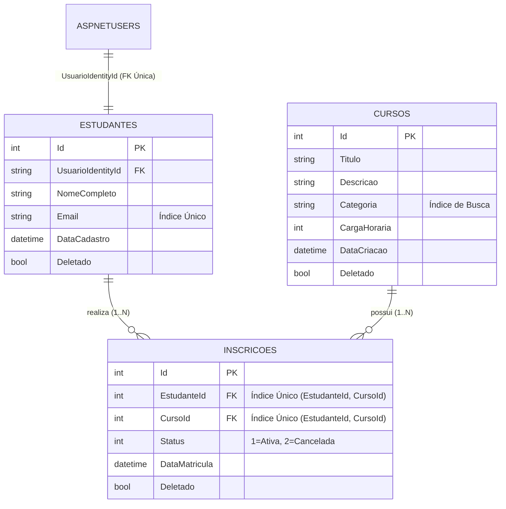

# Plataforma de Cursos API

API RESTful desenvolvida em **.NET 8** para gestão de catálogo de cursos, perfis de estudantes e fluxo transacional de matrículas, integrada ao **ASP.NET Core Identity** e autenticação via **JWT Bearer**.

## Como Rodar Localmente (Início Rápido)

### Pré-requisitos
* [.NET 8 SDK](https://dotnet.microsoft.com/download/dotnet/8.0)
* Servidor **MySQL 8.0+** ativo localmente
* Ferramenta CLI do EF Core: `dotnet tool install --global dotnet-ef --version 8.0.*`

### 1. Clonar o repositório e restaurar pacotes
```bash
git clone [https://github.com/SEU_USUARIO/PlataformaDeCursos.git](https://github.com/SEU_USUARIO/PlataformaDeCursos.git)
cd PlataformaDeCursos/PlataformaDeCursos
dotnet restore
```

### 2. Configurar variáveis e segredos (`user-secrets`)
Nunca salve senhas no `appsettings.json`. Configure a string de conexão e a chave do JWT usando o Secret Manager do .NET:

```bash
dotnet user-secrets set "ConnectionStrings:CursoConnection" "Server=localhost;Database=usuariodb;Uid=root;Pwd=SUA_SENHA;"
dotnet user-secrets set "Jwt:Key" "SuaSuperChaveSecretaMuitoSeguraParaOProjeto2024!"
dotnet user-secrets set "Jwt:Issuer" "PlataformaDeCursosAPI"
dotnet user-secrets set "Jwt:Audience" "PlataformaDeCursosApp"
```

### 3. Aplicar Migrations e Iniciar a Aplicação
```bash
dotnet ef database update
dotnet run
```

### 4. População Inicial Automática (Seed)
Ao iniciar a aplicação, a classe `DbSeeder` verifica o banco e cria automaticamente os papéis (`Admin`, `Instructor`, `Student`) e a conta administrativa inicial:
* **E-mail:** `admin@plataforma.com`
* **Senha:** `Admin@123!`

## Arquitetura e Modelagem de Dados

A aplicação separa as credenciais de autenticação (`AspNetUsers` do Identity) dos dados de domínio do aluno (`Estudantes`), utilizando índice único composto em `Inscricoes` (`EstudanteId + CursoId`) e exclusão lógica (*Soft Delete* via coluna `Deletado`).



## Como Autenticar e Testar no Swagger

1. Com a API em execução, acesse `https://localhost:7280/swagger` no navegador.
2. Na tag **Auth**, execute o endpoint `POST /api/auth/login` informando o e-mail `admin@plataforma.com` e a senha `Admin@123!`.
3. Copie o valor da propriedade `accessToken` retornada no JSON de resposta (`200 OK`).
4. Clique no botão **Authorize** (ícone de cadeado no canto superior direito do Swagger).
5. Cole apenas o token no campo **Value**, clique em **Authorize** e depois em **Close**.

## Principais Endpoints da API

* **`POST /api/auth/register`** (`Anônimo`): Registra novo usuário no Identity com papel `Student` e cria o perfil em `Estudantes`.
* **`POST /api/auth/login`** (`Anônimo`): Autentica credenciais e emite o token JWT Bearer.
* **`GET /api/Cursos`** (`Anônimo`): Lista cursos ativos com paginação (`pagina`, `tamanhoPagina`), filtro por `categoria`, `busca` textual e `ordenarPor` (`titulo`, `data`).
* **`GET /api/Cursos/{id}`** (`Anônimo`): Retorna os detalhes de um curso específico.
* **`POST /api/Cursos`** (`Admin, Instructor`): Cria um novo curso (mínimo de 3 caracteres no título).
* **`PUT /api/Cursos/{id}`** (`Admin, Instructor`): Atualiza dados de um curso existente.
* **`DELETE /api/Cursos/{id}`** (`Admin`): Realiza a exclusão lógica (*soft delete*) do curso.
* **`POST /api/Estudantes`** (`Admin`): Vincula manualmente um `UsuarioIdentityId` a um novo perfil de estudante.
* **`GET /api/Estudantes`** (`Admin`): Lista todos os estudantes ativos.
* **`GET /api/Estudantes/me`** (`Autenticado`): Retorna os dados do próprio estudante logado a partir do token.
* **`GET /api/Estudantes/{id}`** (`Admin ou Próprio`): Detalha o perfil se o usuário for Admin ou dono do registro.
* **`PUT /api/Estudantes/{id}`** (`Admin ou Próprio`): Atualiza nome e e-mail (retorna `409 Conflict` se o e-mail já estiver em uso).
* **`DELETE /api/Estudantes/{id}`** (`Admin`): Desativa o perfil do estudante via *soft delete*.
* **`POST /api/Inscricoes`** (`Autenticado`): Matricula o aluno no curso dentro de uma transação (identifica o estudante pelo token ou exige `estudanteId` se chamado por `Admin`).
* **`GET /api/estudantes/{estudanteId}/inscricoes`** (`Admin ou Próprio`): Lista matrículas do estudante com paginação e filtro por `status`.
* **`DELETE /api/Inscricoes/{id}`** (`Admin ou Próprio`): Cancela a matrícula respeitando o prazo de 7 dias para estudantes.

## Executando Testes

* **Coleção HTTP (Visual Studio / VS Code):** Abra o arquivo `PlataformaDeCursos/PlataformaDeCursos.http`, execute a requisição de login, cole o token na variável `@token` e execute os cenários de curso, estudante e matrícula.
* **Linha de comando (Testes Automatizados):**
  ```bash
  dotnet test
  ```

## Problemas Comuns e Soluções Rápidas (Troubleshooting)

* **Erro `Unable toConnect to any of the specified MySQL hosts` ou falha de autenticação no banco:**
  Verifique se o serviço do MySQL está rodando localmente e se a chave `ConnectionStrings:CursoConnection` foi definida corretamente no `dotnet user-secrets list`.
* **Erro `Table 'usuariodb.aspnetroles' doesn't exist` ao iniciar:**
  As migrações ainda não foram aplicadas ao esquema atual. Execute `dotnet ef database update` dentro da pasta `PlataformaDeCursos/`.
* **Erro `System.TypeLoadException` ao rodar `dotnet ef migrations`:**
  Conflito entre a versão global do `dotnet-ef` e os pacotes `.NET 8` do projeto. Atualize a ferramenta para a versão 8 com `dotnet tool update --global dotnet-ef --version 8.0.*`.
* **Retorno `401 Unauthorized` no Swagger mesmo após fazer login:**
  Ao colar o token na janela **Authorize** do Swagger, insira **apenas** o código do token JWT, sem escrever a palavra `Bearer` antes.
